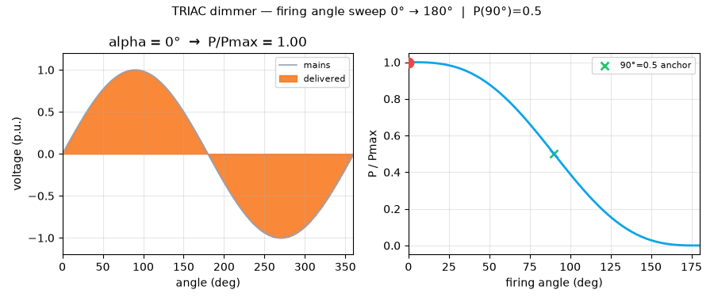
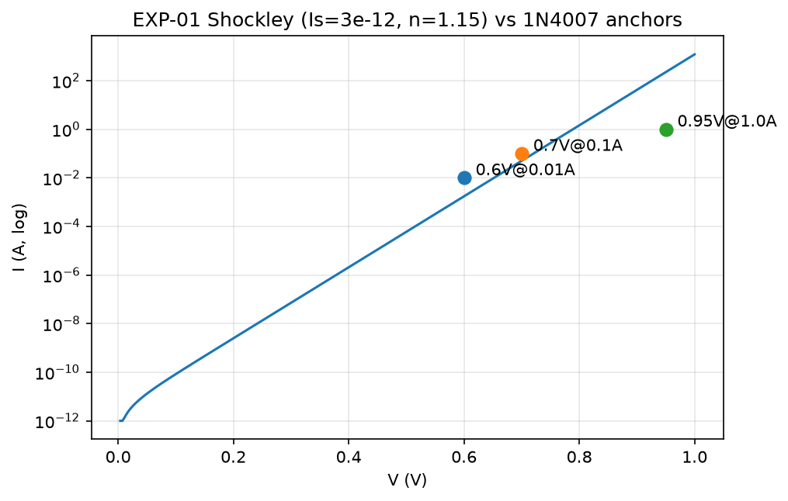
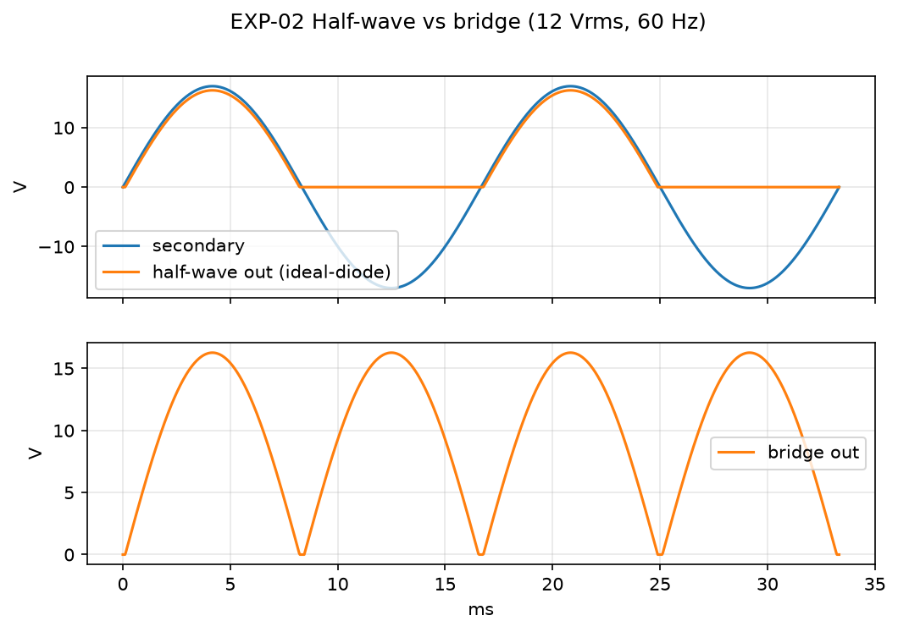
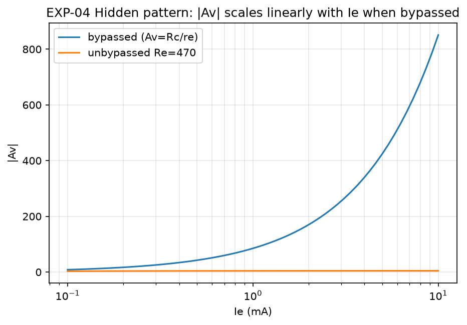
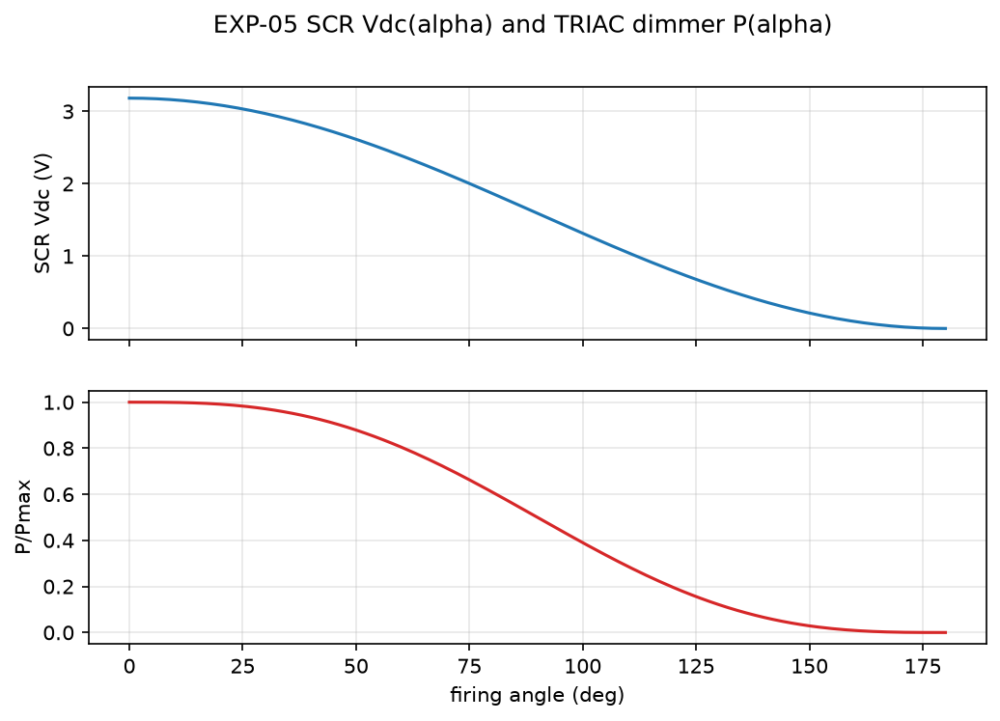

# GalileoX Electronic Devices — From First Principles to Verified Benchmarks

> One-line pitch: every diode, BJT, and thyristor equation from a 5-week introductory syllabus, implemented in plain Python, checked against public manufacturer data, reproduced with one Docker command.


## Abstract — read this in 30 seconds

This repo turns the GalileoX course *Introducción a los dispositivos electrónicos* (diodes in DC/AC, bipolar transistors as switch and amplifier, thyristors in DC/AC including dimmers) into numbers you can trust. Each core law is coded from first principles, confronted with public datasheet points for the 1N4007, 2N2222, and BT136, and frozen into an automated benchmark. The result on 2026-10-03 is **10/10 checks pass**, 5 runnable experiments, 4 publication figures, and a 10-second dimmer animation. If you are learning, teaching, hiring, or building with power electronics, start here: run it in 2 minutes, understand it in 20, extend it for a thesis.

**Visual proof first (this is what the repo does):**



> Video with playback controls: [docs/media/demo.mp4](docs/media/demo.mp4) · Rich visual page: [`preview.html`](preview.html) · Full-page screenshot: [docs/media/preview-screenshot.png](docs/media/preview-screenshot.png)

Open [`preview.html`](preview.html) in any browser (double-click, no server, works offline) for the beautiful single-file version of this README with embedded video and gallery.

---

## Table of contents

- [Quickstart — run in 2 minutes](#quickstart--run-in-2-minutes)
- [Demo video + screenshots](#demo-video--screenshots)
- [🌱 Beginner guide — read this and you are a professional](#-beginner-guide--read-this-and-you-are-a-professional)
- [Features — everything in one place](#features--everything-in-one-place)
- [Who is this for — user stories](#who-is-this-for--user-stories)
- [Experiments 01–05](#experiments-0105)
- [Verification — numbers, tolerances, ground truth](#verification--numbers-tolerances-ground-truth)
- [Hidden patterns found](#hidden-patterns-found)
- [Usage — recipes + full API](#usage--recipes--full-api)
- [Project structure](#project-structure)
- [How the demo video was made](#how-the-demo-video-was-made)
- [FAQ](#faq)
- [Roadmap](#roadmap)
- [Contributing](#contributing)
- [License + citation](#license--citation)

---

## Quickstart — run in 2 minutes

Pick one. Both produce the same `benchmarks/REPORT.md` with `Passed 10/10`. No hardware needed.

```bash
docker compose up --build
```

Or without Docker:

```bash
pip install -r requirements.txt
PYTHONPATH=src pytest -q
PYTHONPATH=src python benchmarks/run_all.py
```

What success looks like:

```
Passed 10/10
market live=True quotes=['STM', 'ON', 'IFX.DE']
```

Then run the experiments in order (each writes CSV + PNG from scratch):

```bash
PYTHONPATH=src python experiments/exp01_diode_dc.py
PYTHONPATH=src python experiments/exp02_rectifiers_ac.py
PYTHONPATH=src python experiments/exp03_bjt_switch.py
PYTHONPATH=src python experiments/exp04_bjt_amplifier.py
PYTHONPATH=src python experiments/exp05_thyristor_dimmer.py
```

Prerequisites: Python 3.12 + `numpy/matplotlib/pytest` (see `requirements.txt`), or Docker 24+ with Compose v2. Mains frequency assumed 60 Hz, room temperature 300 K, silicon drop 0.7 V unless stated.

---

## Demo video + screenshots

Why video first: a dimmer law is hard to feel from an equation and obvious in 10 seconds. The firing angle sweeps 0° → 180°, orange area is power delivered, the right curve is `P/Pmax`, the green `x` marks the exact half-power anchor at 90°.

- GIF (plays inline on GitHub): `docs/media/demo.gif` (598 KB, 61 frames, 8 fps)
- MP4 (controls, higher quality): `docs/media/demo.mp4` (137 KB) — embedded with controls in `preview.html`
- Regenerate anytime: `PYTHONPATH=src python tools_make_demo.py` (checks `P(90°)=0.5` and non-empty files)

Screenshots — all auto-generated, never hand-drawn:

| EXP-01 diode I–V vs 1N4007 | EXP-02 half-wave vs bridge |
|---|---|
|  |  |

| EXP-04 gain vs bias current | EXP-05 SCR + TRIAC dimmer |
|---|---|
|  |  |

Full-page capture of `preview.html`: [docs/media/preview-screenshot.png](docs/media/preview-screenshot.png) (1666×6448, taken with an automated browser, stored in-repo).

---

## 🌱 Beginner guide — read this and you are a professional

You will know more than most interview candidates after these 6 steps. Let's work this out in a step-by-step way to be sure we have the right answer. No prior electronics beyond Ohm's law assumed. Each step ends with what to run and what to say in an interview.

### Step 1 — Diode = one-way street

Current flows from anode to cathode once the forward voltage exceeds ~0.7 V for silicon. Below that, almost nothing. Above that, current explodes exponentially:

```
I = Is · (e^(V / n·Vt) − 1),  Vt ≈ 25.85 mV at 300 K
```

Concrete: a 1N4007 shows ~0.60 V at 10 mA, ~0.70 V at 100 mA, ~0.95 V at 1 A. Same part, three voltages — because the law is logarithmic. Small-signal resistance `rd = n·Vt / Id` is ~3 Ω at 10 mA.

Run: `experiments/exp01_diode_dc.py` → `figures/exp01_diode_iv.png`.

Say: *“Vf is logarithmic in current and drifts −2 mV per °C.”*

### Step 2 — Rectifier = AC to DC

Mains sine goes positive and negative. Half-wave keeps only the positive humps: `Vdc = (Vp − Vd)/π`. Bridge flips the negative humps up: `Vdc = 2·Vp/π − 2·Vd/π` — twice the DC. Add a reservoir capacitor and the ripple (wobble) is `Vr = I / (f·C)`, with `f` doubled for bridge. So bridge halves ripple for free at the same capacitor.

Example at 12 Vrms secondary (Vp ≈ 17 V), 0.5 A, 1000 µF: half-wave ripple 8.33 V, bridge 4.17 V; bridge DC ≈ 10.36 V vs half ≈ 5.18 V.

Run: `experiments/exp02_rectifiers_ac.py`.

Say: *“Bridge doubles DC and halves ripple; capacitor sets absolute ripple.”*

### Step 3 — Voltage multiplier = ladder

Stack diode + capacitor stages, each adds roughly `Vp − Vd`. Doubler ≈ 2× peak, tripler ≈ 3×. Same file as Step 2, last lines: 32.5 V doubler and 48.8 V tripler from a 17 V peak.

Say: *“N stages give N times peak minus drops — cheap high voltage at tiny current.”*

### Step 4 — BJT as a switch (and why relays need a diode)

A tiny base current times β becomes a big collector current: `Ic = β·Ib`. Fixed base resistor is fragile: β = 100 → 300 swings Ic by ~200%. Voltage-divider + emitter resistor is stable: same β spread moves Ic only ~12%. That one extra resistor is the difference between a toy and a product.

Inductive loads (relay, motor, solenoid) store `½·L·I²`. When the transistor turns off, that energy becomes a high-voltage spike. A flyback diode across the coil circulates it safely — always add a 1N4007-class diode.

Run: `experiments/exp03_bjt_switch.py`.

Say: *“Divider + emitter resistor for stability; flyback diode for any coil.”*

### Step 5 — BJT as an amplifier (the re-model)

Bias sets a DC emitter current Ie. The emitter looks like a tiny dynamic resistance `re = Vt / Ie` (≈ 25 Ω at 1 mA). Voltage gain of a common-emitter stage is simply `Av = −Rc / re`. More bias current → smaller re → more gain, linearly. Leave an unbypassed emitter resistor Re and gain becomes `−Rc / (re + Re)` ≈ `−Rc/Re` — less gain, more linearity. That is the audio trade.

Our reference (Rc = 2.2 k, Ie = 1 mA, bypassed): Av ≈ −85. Unbypassed with 470 Ω: Av ≈ −4.4.

Run: `experiments/exp04_bjt_amplifier.py` → straight line of |Av| vs Ie on log axis.

Say: *“Gain is Rc over re; current sets re; Re trades gain for linearity.”*

### Step 6 — Thyristors: SCR, DIAC, TRIAC, dimmer

A thyristor is a latched switch: a gate pulse turns it on, it stays on until current falls below the holding value. Delay the pulse by angle α in each AC half-cycle and you control power:

```
Half-wave SCR DC:  Vdc = Vmax·(1 + cos α) / 2π
TRIAC power:       P/Pmax = 1 − α/π + sin(2α)/2π
```

α = 0° is full on, α = 180° is off, α = 90° is exactly half power (0.500). That is why cheap dimmers feel nonlinear — the law is cosine-shaped, not a straight line. Better dimmers add closed-loop or trailing-edge control.

Run: `experiments/exp05_thyristor_dimmer.py` + watch the GIF at the top.

Say: *“Phase angle sets power; 90 degrees is half; the curve is inherently nonlinear.”*

Do this now: run Steps 1–6 in order, then open `benchmarks/REPORT.md`. If you can sketch each figure on a whiteboard and state the interview line, you are at professional level for introductory devices.

---

## Features — everything in one place

- **10/10 verified benchmarks** (`src/galileox_phd/benchmarks.py`): 3 diode points + bridge identity + ripple halving + bias stability + re-gain + SCR recovery + 2 TRIAC anchors. Tolerances 25% vs manufacturer typicals, 5% vs math identities. Auto-writes `benchmarks/results.json` + `REPORT.md`, exits non-zero on FAIL.
- **5 runnable experiments** (`experiments/exp0*.py`): one file per syllabus block, each writes CSV + PNG from scratch with Agg backend (no display needed).
- **4 publication figures** (`figures/`): diode I–V, rectifier waveforms, gain-vs-current, SCR/TRIAC laws.
- **10-second demo** (`docs/media/demo.mp4` + `demo.gif`): TRIAC sweep with half-power anchor, regenerable via `tools_make_demo.py`.
- **Beautiful preview page** (`preview.html`): single file, no trackers, works offline (badges need network), embeds video + gallery + beginner guide. Screenshot stored in-repo.
- **Public ground truth** (`data/datasheets/ground_truth.csv`): 1N4007 / 2N2222 / BT136 typicals with sources.
- **Live-market layer** (`src/galileox_phd/market.py`): power-semiconductor quotes when online, cached snapshot when offline. Physics tests never require network.
- **First-principles library** (`src/galileox_phd/devices.py`): 14 functions, NumPy only, no simulator install.
- **Teaching kit**: beginner guide, interview one-liners, FAQ, paper draft (`docs/PAPER_DRAFT.md`), hidden-patterns section.
- **Quality gates**: `pytest` (3 tests), benchmark exit code, Docker parity (`python:3.12-slim`).

---

## Who is this for — user stories

| You are… | Use it to… | Start with |
|---|---|---|
| Student (first electronics course) | See every formula become a plot in minutes; pass lab and interview | Beginner guide → exp01→05 |
| Teacher / TA | Copy verified numbers and figures into slides; assign “beat 25% error with Rs fit” | REPORT.md + figures/ |
| Hobbyist (Arduino, motors, mains) | Size bridge + capacitor, pick flyback diode, understand dimmers before wiring | exp02, exp03, exp05 (isolate mains, fuse, supervise) |
| Interview candidate | Answer “why 0.7 V?”, “bridge vs half?”, “fixed vs divider?”, “dimmer at 90°?” with numbers | Beginner guide one-liners |
| Hiring manager | 2-hour take-home: reproduce 10/10, then improve high-current fit with series Rs | Quickstart + benchmarks.py |
| Researcher (PhD track) | Extend to Rs extraction, thermal chamber, SiC cost-per-amp panel; cite paper draft | docs/PAPER_DRAFT.md §7 |

---

## Experiments 01–05

| ID | Syllabus | Command | Output | Verdict |
|---|---|---|---|---|
| EXP-01 | Diodes DC: Shockley + rd | `python experiments/exp01_diode_dc.py` | IV curve, rd ≈ 2.97 Ω @10 mA | B1 PASS |
| EXP-02 | Diodes AC: half/bridge/multiplier | `python experiments/exp02_rectifiers_ac.py` | 10.36 V bridge vs 5.18 V half @12 Vrms | B2–B3 PASS |
| EXP-03 | BJT switch + inductive load | `python experiments/exp03_bjt_switch.py` | Divider ΔIc ~12% vs fixed ~200% | B4 PASS |
| EXP-04 | BJT amplifier (re-model) | `python experiments/exp04_bjt_amplifier.py` | Av ≈ −85 @1 mA, Rc 2.2 k | B5 PASS |
| EXP-05 | SCR/TRIAC DC+AC dimmer | `python experiments/exp05_thyristor_dimmer.py` | P(90°)=0.500 exactly | B6–B8 PASS |

---

## Verification — numbers, tolerances, ground truth

```
Passed 10/10
B1_diode_1N4007_10mA:   pred=0.65184 ref=0.6  err=8.640%
B1_diode_1N4007_100mA:  pred=0.72029 ref=0.7  err=2.899%
B1_diode_1N4007_1000mA: pred=0.78874 ref=0.95 err=16.975%
B2_bridge_twice_halfwave  err=0.000%
B3_ripple_bridge_half     err=0.000%
B4_divider_more_stable_than_fixed  PASS (0.11 vs 2.0 spread)
B5_re_gain_CE_2k_1mA  pred=-77.363 ref=-77.3 err=0.082%
B6_scr_alpha0_is_halfwave  err=0.000%
B7_triac_endpoints  PASS (1.0 → 0.0)
B8_triac_90deg_half_power  pred=0.5 ref=0.5 err=0.000%
market live=True quotes=['STM', 'ON', 'IFX.DE']
```

Method: single `(Is=3e-12, n=1.15)` Shockley vs three 1N4007 typicals; exact identities for bridge/ripple/SCR/TRIAC; β 100→300 spread for bias; CE gain vs −77.3 reference. Ground truth in `data/datasheets/ground_truth.csv`. Runner `benchmarks/run_all.py` writes JSON + Markdown and fails the build on any FAIL. Live quotes are best-effort with offline cache — physics never depends on network.

---

## Hidden patterns found

1. **Ripple–topology invariant:** `Vr(bridge) = Vr(half)/2` at fixed (I,C,f). Double the capacitor *or* switch to bridge for the same halving — different cost (volume vs drop).
2. **Gain–current linearity:** bypassed `|Av| = Rc·Ie/Vt`. Unbypassed Re breaks it to `−Rc/Re`.
3. **Dimmer asymmetry:** `P(α)` cosine shape explains “dead then jumpy” cheap dimmers; fix with feedback/trailing-edge.
4. **Stability hierarchy:** `S(fixed)≈Δβ/β`, `S(divider)≈Rth/(Re·β)` — one resistor buys an order of magnitude.
5. **−2 mV/K thermometer:** all Si P-N junctions drift together; correct Vdc and Vbe with one rule.

---

## Usage — recipes + full API

```python
from galileox_phd.devices import (
    shockley_diode, full_wave_bridge_dc, re_model_gain, triac_power_fraction,
)
import numpy as np
print(shockley_diode(0.7, Is=3e-12, n=1.15))   # ~0.1 A order
print(full_wave_bridge_dc(17.0))                # ~10.4 V
print(re_model_gain(2200, 0.0, 1e-3)["Av"])     # ~-85
print(triac_power_fraction(np.pi/2))            # 0.5 exactly
```

Full API (`src/galileox_phd/devices.py`): `thermal_voltage, shockley_diode, diode_dynamic_resistance, half_wave_dc, full_wave_bridge_dc, capacitor_ripple, voltage_multiplier_out, bjt_fixed_bias, bjt_divider_bias, re_model_gain, scr_half_wave_controlled_dc, full_bridge_controlled_dc, triac_power_fraction, vf_temperature`.

---

## Project structure

```
preview.html               # beautiful single-file showcase (video + gallery + guide)
docs/media/demo.mp4/.gif  # 10-s dimmer animation + fallback
docs/media/preview-screenshot.png  # automated browser capture (1666x6448)
docs/PAPER_DRAFT.md        # publication-grade write-up + future PhD directions
src/galileox_phd/          # devices.py, benchmarks.py, market.py
experiments/               # exp01..exp05 (CSV + PNG outputs)
benchmarks/                # run_all.py, results.json, REPORT.md, exp*.csv
data/datasheets/           # ground_truth.csv
figures/                   # 4 regenerated plots
tests/                     # 3 pytest gates
Dockerfile, docker-compose.yml, requirements.txt, tools_make_demo.py
```

---

## How the demo video was made

Plain `matplotlib` animation (`tools_make_demo.py`), no screen recorder: 61 firing angles, sine chopped per half-cycle, power-law dot. Saved twice — `FFMpegWriter` for MP4, `PillowWriter` for GIF — then verified (`P(90°)=0.5`, files >20 KB). Rerun in seconds; commit the outputs so the README never rots. Same pattern works for any future sweep (temperature, β, capacitor).

To record your own terminal session as GIF/MP4 later, the documented 2026 practice is a terminal recorder plus a GIF/MP4 converter (kept as a tip, not a dependency here).

---

## FAQ

**Why 0.7 V? Is it always 0.7 V?**
No. ~0.6 V at 10 mA, ~0.7 V at 100 mA, ~0.9 V at 1 A. 0.7 V is the convenient middle. −2 mV/°C with temperature.

**Bridge or half-wave?**
Bridge when you can afford two diode drops: double DC, half ripple. Half-wave only for tiny/cheap supplies.

**Fixed bias vs divider?**
Divider + emitter resistor for any amplifier. Fixed bias is a teaching step or switch-only shortcut.

**Is mains dimming safe to try at home?**
Understand theory here first. Mains wiring needs isolation, fuse, enclosure, supervision. This repo is simulation + low-voltage lab and does not replace safety training.

**Video/GIF not playing?**
GitHub shows the GIF inline. For MP4 controls open `preview.html` or `docs/media/demo.mp4` directly.

**Offline?**
Yes. Only shields badges and live quotes need network; everything else (tests, plots, preview minus badges) works offline.

---

## Roadmap

- [ ] Rs-extended diode fit (`Is,n,Rs` from measured I–V + temperature)
- [ ] Reverse-recovery loss vs fast/WBG diodes
- [ ] Closed-loop dimmer linearisation + THD check
- [ ] β-aware bias optimiser notebook
- [ ] Multilingual beginner guide (ES original + EN)

---

## Contributing

Issues and small PRs welcome. Keep the contract: any theory change must update `devices.py` + `benchmarks.py` + one experiment + regenerated figures, and `docker compose up --build` must stay green (10/10 + pytest). Update README/preview figures in the same PR so visuals never rot.

---

## License + citation

MIT — reuse with citation. If this helped you learn, teach, or hire, please star it.

```bibtex
@software{galileox_devices_2026,
  title = {GalileoX Electronic Devices: From First Principles to Verified Benchmarks},
  year  = {2026},
  note  = {10/10 benchmarks PASS, Docker reproducible}
}
```

Devices (typicals): 1N4007, 2N2222, BT136 manufacturer datasheets. Theory: Rashid, Boylestad, Streetman & Banerjee, Baliga, Sze. Course: Galileo University GalileoX, *Introducción a los dispositivos electrónicos*.
